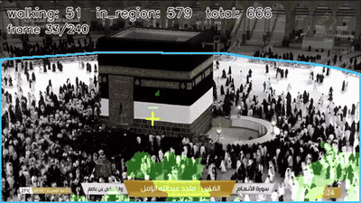
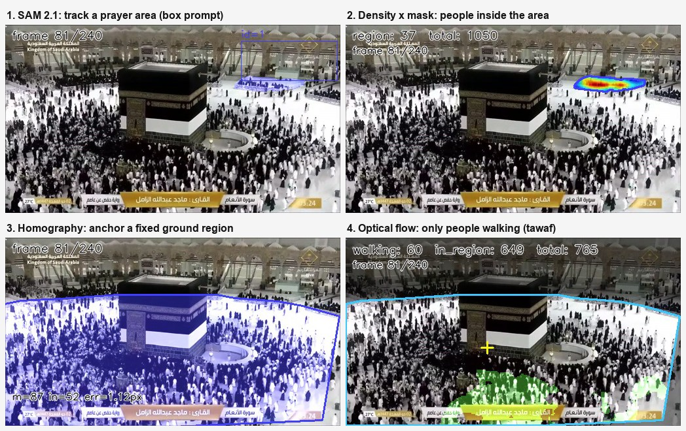

# Tracking Prayer Areas for Per-Zone Crowd Counting

Prayer areas aren't fixed polygons. They fill row by row, spill into aisles, and empty again after the prayer. A static zone mask drawn once over a camera view will over- or under-count as the crowd moves. This repo **tracks the area itself** from frame to frame and counts only the people inside it.



*Public TV broadcast of Masjid al-Haram. The blue outline is a ground region tracked by homography; green marks people moving around the Kaaba (tawaf). The overlay shows walking / in-region / whole-frame counts.*

## Pipeline



| Stage | Script | What it does |
|---|---|---|
| 1. Track an area whose shape changes | [`run_sam2.py`](scripts/run_sam2.py) | SAM 2.1 video predictor, seeded with a box or polygon on one frame, propagates the mask through the clip. The mask grows and shrinks with the crowd. |
| 2. Count inside it | [`count_in_region.py`](scripts/count_in_region.py) | CLIP-EBC density map per frame (sliding 224×224 windows at native resolution), summed only inside the mask → per-frame CSV + annotated video. |
| 3. Track a fixed patch of ground | [`track_region_homography.py`](scripts/track_region_homography.py) | ORB or SIFT features + RANSAC homography from a reference frame warp a hand-drawn polygon onto every frame. |
| 4. Count only people walking | [`count_walking_in_region.py`](scripts/count_walking_in_region.py) | Dense optical flow (Farnebäck), decomposed into radial and tangential parts around a centre point. A pixel counts as walking when its motion runs *around* the centre, not towards it or away from it. |

Stages 1 and 3 export the same mask format (`obj_<id>` → `(T, H, W)` bool NPZ), so either tracker feeds either counter.

### Which tracker to use

| Scene | Tracker | Why |
|---|---|---|
| Fixed camera, and the area itself changes shape | SAM 2.1 | Follows appearance, so the mask expands as rows fill |
| Moving or zooming camera, fixed ground area | Homography | The ground is planar, so a 3×3 warp keeps the polygon pixel-exact |

## What didn't work first

**SAM 2.1 under heavy zoom.** On a zooming aerial clip, the SAM 2.1 mask ballooned until it covered every ground-looking pixel. SAM tracks *appearance*, and under zoom the whole courtyard looks like the prompted patch. The homography tracker replaced it for those shots. It anchors geometry instead of appearance, and when matching fails (too few inliers or high reprojection error) it reuses the last good homography and tints the frame red with a `FALLBACK` label. That way you can see bad frames instead of having them silently corrupt the count. `--diagnostics` writes per-frame matches, inliers and reprojection error to a CSV.

**Box prompts on oblique views.** A rectangle around a non-axis-aligned prayer area includes aisles and walls. [`draw_polygon.py`](scripts/draw_polygon.py) lets you trace the barrier or carpet edge instead, and `run_sam2.py` seeds SAM with the rasterised polygon.

## Setup

Tested on a 4 GB NVIDIA MX150 with `sam2.1_hiera_tiny`; frames are extracted at 512 px on the long side to fit in memory.

```bash
python -m venv .venv && .venv\Scripts\activate          # Windows; use source .venv/bin/activate elsewhere

# 1. CUDA torch first, or SAM 2 pulls a CPU build
pip install torch torchvision --index-url https://download.pytorch.org/whl/cu124

# 2. SAM 2 at the commit this was built on
git clone https://github.com/facebookresearch/sam2.git external/sam2
git -C external/sam2 checkout 2b90b9f5ceec907a1c18123530e92e794ad901a4
pip install -e external/sam2
pip install -r requirements.txt

# 3. SAM 2.1 checkpoint into checkpoints/
#    https://dl.fbaipublicfiles.com/segment_anything_2/092824/sam2.1_hiera_tiny.pt

# 4. ffmpeg on PATH (or set FFMPEG=/path/to/ffmpeg, or put it in tools/ffmpeg/)

python scripts/check_env.py
```

**Counting stages only:** clone [CLIP-EBC](https://github.com/Yiming-M/CLIP-EBC) into `external/CLIP-EBC` (or pass `--clip-ebc`) and pass `--weights` with a CLIP-EBC ViT-B/16 checkpoint. The original pretrained UCF-QNRF weights work; so does a LoRA fine-tune (see [mosque-crowd-counting](https://github.com/hamzamshabi/mosque-crowd-counting) for training).

## Run

Put a video in `videos/`. The prompts in [`examples/prompts/`](examples/prompts) match 512-px frames of the example clip; for any other video, draw your own with `draw_box.py`, `draw_polygon.py` or `draw_point.py` (click, ENTER to save).

```bash
python scripts/extract_frames.py --video videos/example.mp4 --duration 60 --fps 4 --max-side 512 --out frames/example

# SAM 2.1 track + count inside it
python scripts/run_sam2.py --frames frames/example --prompt examples/prompts/youtube_box.json \
    --out outputs/segmented.mp4 --export-masks outputs/masks_sam2.npz
python scripts/count_in_region.py --frames frames/example --masks outputs/masks_sam2.npz \
    --weights path/to/clip_ebc.pth --out outputs/counted.mp4 --csv outputs/counts.csv

# homography track + walking count
python scripts/track_region_homography.py --frames frames/example --prompt examples/prompts/youtube_mataf_polygon.json \
    --out outputs/region.mp4 --export-masks outputs/masks_hom.npz --diagnostics outputs/hom_diag.csv
python scripts/count_walking_in_region.py --frames frames/example --masks outputs/masks_hom.npz \
    --center examples/prompts/youtube_kaaba_center.json --weights path/to/clip_ebc.pth --out outputs/walking.mp4
```

Useful flags: `run_sam2.py --model base_plus` (larger SAM), `track_region_homography.py --detector sift` (wider zoom range) and `--min-inliers 12` (fewer fallbacks), `count_walking_in_region.py --flow-threshold / --tangent-ratio` (walking sensitivity), `--polygon` instead of `--masks` for a static region.

## Notes

- The counts in the images are model estimates. There is no ground truth for this clip.
- Example footage: a public TV broadcast of Masjid al-Haram, published on YouTube. The video isn't redistributed here.
- Built as part of a mosque crowd-monitoring project. Site camera footage from that project is private and isn't used anywhere in this repo.

## Credits

[SAM 2](https://github.com/facebookresearch/sam2) (Meta AI, Apache 2.0) · [CLIP-EBC](https://github.com/Yiming-M/CLIP-EBC) (Yiming Ma, MIT) · OpenCV
